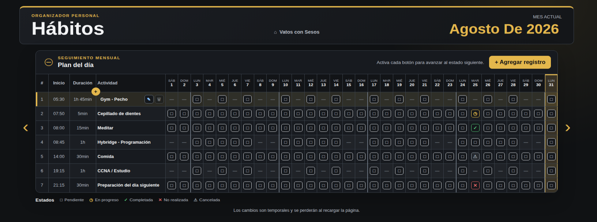
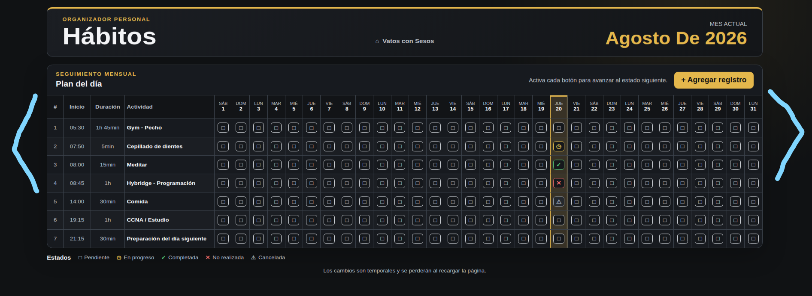
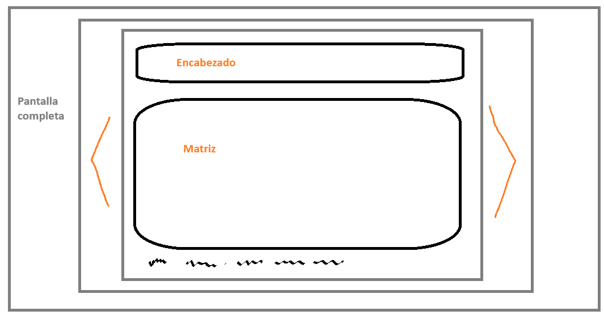

# Fix frontend 2

## Estados de los dias

El flujo que propones esta muy bien. Entiendo que la unica duda que tienes es como seria "Quitar un weekday activo".

Yo pienso que no hay una forma natural de hacerlo, sin embargo el flujo que propones me gusta, pero podría quedar igual de ciclico.

Tu dices que cuando se abre editar y hay por ejemplo:

L = Activo
X = Editar ✎
V = Activo

Me parece perfecto que X este en status de edicion porque es el dia que esta seleccionado, ahora si digamos que se añade un dia:

L = Activo
X = Activo
V = Activo
S = Editar ✎

Ahora sabado esta en Editar, pero si quiero desactivar lunes, forzosamente tendra que tocar luner y pasara an tocarlo  a estar en modo edicion.

L = Editar ✎
X = Activo
V = Activo
S = Activo

Y al siguiente toque queda desactivado.

L = Inactivo/normal
X = Activo
V = Activo
S = Activo

Por eso creo que estuvo muy atinada tu propuesta, pero aun así el ciclo tiene que ser ciclico. No debemos poner mas ecenarios porque eso limitaria el control o libertar de tomar las deciciones que quisiera el usuario.

Imagina que limitamos que solo navegue entre Activo y Editar y que para desactivar tengamos que tocar un boton distinto o cancelar la actividad por fuera o algo diferente a solo navegar por sus estados.

Eso sería darle complejidad y puede que este bien, pero estamos restringiendo la libertad del usuario poniendole pasos extra.

Yo quiero que la app se sienta libre, quiero sentir libertad cuando este navegando por ella, y eso lo puedo hacer si le doy el control al usuario.

Es el punto de la app, que no tenga que estar pensando en sus actividades, que entre a la app y la app sea que la pueda quitarle ese peso al usuario, no haciendo que entre y sienta que para hacer algo tenga que hacer mas pasos extra.

Que de por si ya le estamos metiendo muchas cosas pero considero que son las necesarias para la mejor experiencia.

## flechas de Navegación mensual

codex hizo justo lo que no quería que hiciera y describí justo que ¡no hiciera eso!

Las flechas de navegación estan dentro de lo que anteriormente era el width de la matriz, y eso fue justo lo que describí que no quería.

Lo que quiero ya te lo habia dicho, lo que quiero es como la siguiente imagen.

Hice un dibujo para explicarlo mejor:

No se como haya estructurado codex el frontend, pero me imagino que actualmente todo esta dentro de un div o un main y dentro pues mas divs, infiero que dentro de donde se encuentra la matriz, tambien puso las flechas de navegación y por eso compartio el width con las flechas de navegación. Eso es lo que no queria.

Lo que quiero es que tanto el encabezado, la matriz y el pie compartan el mismo tamaño, por eso lo puse dentro de un cuadro gris y fuera las flechas de navegación que estan dentro de otro cuadro haciendo ilucion a ser otro div que encierra dentro lo demas.

No quiero que haga justamente esto, solo es para dar a entender el como quiero el producto final.
