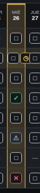

# Fix frontend 3

## Estados de los dias

Creo que tuvimos un mal entendido

El flujo que deben de tener los dias debe ser ciclico

Inactivo  ← ↑
   ↓
Editando ✎  ↑
   ↓
Activo      ↑
   ↓     →

Realmente no hay problema de como esta en este momento funcionando, el tema es que hice algo hace unos dias y esto se interpuso pero ya no recuerdo que hice, no se si deberíamos dejarlo así.

Igual y hay que dejarlo así pero si llegamos a necesitar cambiarlo lo hacemos.

## Duplicacion de estado por modificacion

Hice un experimento y me posicione en el dia 17/09/2026 en la actividad "cepillado de dientes"(Aunque esto no es tan relevante, pudo haber sido X actividad), abrí editar y me fui hasta el ultimo apartado, mostraba la fecha del dia seleccionado.

Sin embargo cambie la fecha y puse el dia 26/08/2026 para modificar ese dia y al guardar se quito el checkbox del dia 17 y en el dia 26 se pusieron dos checkbox, como si hubiera agarrado el del dia 17 de septiembre y lo hubiera llevado al dia 26 de agosto.

Lo que dedusco por esto es que el ultimo apartado pertenece a modificar unicamente el dia seleccionado pero al yo cambiar la fecha altere el sistema, por lo que hay dos soluciones.

1. Primera solucion y la que considero mas facil
   - Seria que bloqueemos el selector de esa fecha para que el usuario no la pueda alterar y que diga fecha del dia seleccionado.
2. 2da solucion. Y sería que si cambio la fecha se modifiquen los parametros de ese dia puesto en el selector, pero no creo sea correcto porque sería mucha revoltura. Mejor que si quieren cambiar cierto dia, se seleccione ese dia en especifico y sería deducible para el usuario y no complicamos el dominio, simplemente no le damos la opción al usuario y restringimos hacer algo así.

Tambien de aqui sacamos una restriccion y es que no se puedan poner mas de un checkbox por dia, se que no son checkbox pero es mi manera de decirtelo.

Y justo te digo esto porque el 26 se quedo como te mostre y para que pudiera volver a poner un checkbox en el 17, me posicione en lunes 14 y tuve que modificar el horario del dia 17 aunque ya aparecia activo en la interfaz justo para que despues darle en aplicar esta semana y se volvio a aparecer el checkbox pero el del 26 quedo doble.

Eso tambien indica que no esta del todo bien vinculada la interfaz con la matriz, porque en primera no debio haber permitido una superposicion y si desaparecio el checkbox del 17 que aparecia como que no estaba esa actividad para ese dia, osea asi (-), a la hora de abrir esta semana no debio aparecer ese jueves, pero esta bien porque entiendo que creo que lo que aparece en la interfaz es el generatorConfig o algo así, ya despues podemos implementar eso, por ahora esa falla es algo que tuvimos que esperar.

## Editar activo en vista mensual

A que me refiero?

Digamos que activo vista mensual, eso hace que se muestren todas las actividades del mes

Y me interesa modificar una actividad, pero si estoy seleccionando un dia en el que no se encuentra agendada esa actividad, no podre dar click en editar, y si por ejemplo es el dia actual en el que quiero agregar esa actividad en el dia actual, por ejemplo hoy es jueves y quiero agregar gym, tendría que posicionarme en un dia que este agendada esa actividad y tendría que modificar esa semana o de aqui en adelante, pero si solo quiero agregarla a ese dia, tambien deberia poder.

O si quisira modificar esa actividad desde el dia seleccionado en adelante debería poderse. Pero solo en vista mensual, en vista diaria pues obvio la actividad no debería ni aparecer.