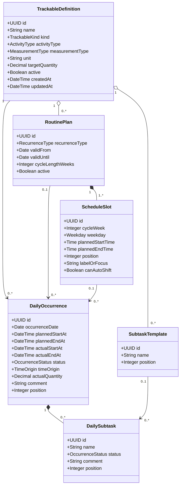

Lo que hiciste **sí es bastante**. Ya pasaste de “quiero un gestor” a describir:

* qué datos aparecen;
* cuándo se modifican;
* cómo reacciona la interfaz;
* qué se conserva como historial;
* qué ocurre con las actividades posteriores.

Eso es justo lo que empieza a convertir una idea en un sistema. Tus bocetos también ayudan muchísimo porque muestran que el centro del módulo no es un calendario genérico, sino una **línea temporal diaria que compara lo planeado con lo ocurrido**. 

Pero encontraste correctamente que las clases actuales “no cuadran”. El problema no está en tu idea: está en que estás intentando guardar en el mismo objeto dos cosas distintas:

```text
La definición general de una actividad
≠
La aparición de esa actividad en un día concreto
```

Esa separación resuelve casi todas tus dudas.

# 1. La corrección conceptual principal

Actualmente imaginaste:

```text
TrackableItem
├── nombre
├── fecha de registro
└── is_done
```

Pero `is_done` no pertenece al elemento general.

Por ejemplo, existe el hábito:

```text
Cepillarse los dientes
```

Ese hábito no está permanentemente realizado o no realizado. Su cumplimiento depende del día:

```text
28 de julio → completado
29 de julio → pendiente
30 de julio → no realizado
```

Por eso no necesitamos un arreglo dentro de `TrackableItem`. Necesitamos **un registro diferente para cada aparición diaria**.

```text
TrackableDefinition
“Cepillarse los dientes”
        │
        ├── DailyOccurrence del 28 de julio → completed
        ├── DailyOccurrence del 29 de julio → pending
        └── DailyOccurrence del 30 de julio → not_completed
```

Lo mismo sucede con los horarios reales: cambian por día y, por tanto, no pertenecen a la definición general. Tú mismo detectaste ese problema en el documento. 

---

# 2. Las tres capas del sistema

Yo modelaría el módulo mediante tres conceptos.

## Definición

Responde:

> ¿Qué cosa es?

Ejemplos:

* Gym;
* cepillarse los dientes;
* trabajar;
* cortarse el cabello;
* ponchadura de llanta.

## Plan o rutina

Responde:

> ¿Cuándo debería aparecer?

Ejemplos:

```text
Gym
Lunes: 5:30–7:15, Pecho
Martes: 5:30–7:15, Espalda
Miércoles: descanso
```

## Aparición diaria

Responde:

> ¿Qué pasó con esa actividad en esta fecha?

Ejemplo:

```text
Gym — 29 de julio

Planeado: 5:30–7:15
Real:     5:45–7:30
Estado:   completado
Comentario: llegué tarde
```

Así conservamos el historial aunque posteriormente cambies la rutina.

---

# 3. No todo necesita convertirse en herencia

Tu sospecha es correcta:

> `AnchorActivity`, `PeriodicActivity` y `UnforeseenActivity` parecen más reglas de negocio que clases con atributos propios.

Yo **no crearía una tabla o subclase para cada una**.

Usaría una sola definición con clasificaciones:

```text
kind
├── ACTIVITY
└── HABIT
```

```text
activity_type
├── ANCHOR
├── PERIODIC
└── UNFORESEEN
```

```text
measurement_type
├── CHECK
├── TIME
└── QUANTITY
```

Eso permite combinaciones claras.

| Ejemplo             | kind     | activity_type | measurement_type |
| ------------------- | -------- | ------------- | ---------------- |
| Trabajo             | ACTIVITY | ANCHOR        | TIME             |
| Cortarse el cabello | ACTIVITY | PERIODIC      | TIME             |
| Ponchadura          | ACTIVITY | UNFORESEEN    | TIME             |
| Despertarse         | HABIT    | —             | TIME             |
| No fumar            | HABIT    | —             | QUANTITY         |
| Leer diariamente    | HABIT    | —             | CHECK o QUANTITY |

Para el hábito “no fumar”:

```text
unit = cigarrillos
target_quantity = 0
```

Pero la cantidad real fumada pertenece al registro del día:

```text
DailyOccurrence.actual_quantity = 3
```

No a la definición general.

---

# 4. Modelo de clases propuesto

## `TrackableDefinition`

Representa la identidad estable del elemento.

```text
TrackableDefinition
-------------------
id
name
kind
activity_type
measurement_type
unit
target_quantity
active
created_at
updated_at
```

Campos como `unit` y `target_quantity` serán opcionales y se usarán más adelante para hábitos cuantitativos.

---

## `RoutinePlan`

Representa una versión de la rutina.

```text
RoutinePlan
-----------
id
trackable_definition_id
recurrence_type
valid_from
valid_until
cycle_length_weeks
active
created_at
updated_at
```

`cycle_length_weeks` permitiría a futuro un trabajo rolado:

```text
Semana 1 → turno matutino
Semana 2 → turno nocturno
```

Para el MVP podría valer siempre:

```text
cycle_length_weeks = 1
```

---

## `ScheduleSlot`

Representa cómo se programa un elemento en un día particular de la rutina.

```text
ScheduleSlot
------------
id
routine_plan_id
cycle_week
weekday
planned_start_time
planned_end_time
position
label_or_focus
can_auto_shift
```

Ejemplo:

```text
routine: Gym
weekday: lunes
planned_start: 05:30
planned_end: 07:15
label_or_focus: Pecho
```

La propiedad:

```text
can_auto_shift
```

indica si la actividad puede ser recorrida automáticamente.

Esto es importante porque una actividad ancla como:

```text
Entrada al trabajo a las 8:00
```

probablemente **no debería moverse automáticamente** solo porque el desayuno terminó tarde.

---

## `DailyOccurrence`

Esta es la entidad más importante: representa un renglón del día.

```text
DailyOccurrence
---------------
id
trackable_definition_id
routine_plan_id
schedule_slot_id
occurrence_date

planned_start_at
planned_end_at

actual_start_at
actual_end_at

status
time_origin
actual_quantity
comment
position

created_at
updated_at
```

Los campos reales comienzan como `NULL`.

No conviene guardar inicialmente:

```text
actual_start_at = planned_start_at
actual_end_at = planned_end_at
```

porque entonces perderíamos esta información:

> ¿El usuario confirmó tiempos reales o la aplicación solo está mostrando los planeados?

La interfaz puede utilizar una sustitución visual:

```text
Si actual_start_at existe:
    mostrar actual_start_at
Si no:
    mostrar planned_start_at
```

Así obtienes exactamente la presentación que describiste sin falsear los datos.

---

## Estados

Un booleano `is_done` se queda corto.

Usaría:

```text
PENDING
IN_PROGRESS
COMPLETED
NOT_COMPLETED
CANCELLED
```

La diferencia es importante:

* `NOT_COMPLETED`: estaba planeada, pero no se realizó.
* `CANCELLED`: se quitó del plan de ese día.
* `IN_PROGRESS`: ya empezó, pero todavía no terminó.

Por eso, al “eliminar” la actividad del día, **no deberíamos asignar `is_done = false`**. Eso convertiría una cancelación en un incumplimiento.

Debe quedar:

```text
status = CANCELLED
```

Podemos ocultarla de la vista cotidiana, pero conservarla en la base.

---

## Origen de los tiempos reales

Para saber qué horarios puede recalcular la aplicación:

```text
time_origin
├── PLANNED
├── AUTO_SHIFTED
└── MANUAL
```

* `PLANNED`: todavía se usa visualmente el horario planeado.
* `AUTO_SHIFTED`: el sistema lo recorrió.
* `MANUAL`: el usuario escribió ese horario y no debe sobrescribirse automáticamente.

---

## Subactividades

Para una rutina recurrente necesitamos dos niveles:

```text
SubtaskTemplate
---------------
id
trackable_definition_id o schedule_slot_id
name
position
```

```text
DailySubtask
------------
id
daily_occurrence_id
source_template_id
name
status
comment
position
```

La plantilla dice:

```text
Escuela
├── Programación
└── Matemáticas
```

Y cada día recibe sus propias copias:

```text
Lunes: Matemáticas → completada
Jueves: Matemáticas → pendiente
```

---

# 5. UML inicial

Este sería mi primer diagrama, todavía sujeto a lo que definamos en las vistas:



No significa que obligatoriamente cada clase deba convertirse exactamente en una tabla. Es primero un **modelo del dominio**.

---

# 6. Duración estimada y duración real

Tu razonamiento es correcto: inicialmente no las guardaría.

Se calculan así:

```text
estimated_duration =
planned_end_at - planned_start_at
```

```text
real_duration =
actual_end_at - actual_start_at
```

Serían propiedades calculadas:

```python
@property
def estimated_duration(self):
    return self.planned_end_at - self.planned_start_at
```

Ventajas:

* no duplicas datos;
* evitas inconsistencias;
* si corriges una hora, la duración queda actualizada automáticamente;
* PostgreSQL también puede calcularla para análisis futuros.

Solo las guardaríamos después si aparecen problemas reales de rendimiento o una necesidad estadística especial.

---

# 7. La interfaz temporal que diseñaste

La idea general está muy clara:

## Estado resumido

Debe mostrar:

```text
hora efectiva de inicio
duración efectiva
nombre
```

“Efectivo” significa:

```text
actual, si existe;
planeado, si no existe.
```

## Estado expandido

El término correcto sería:

* **colapsado** = cerrado o resumido;
* **expandido** = abierto o detallado.

El control:

```text
> Seguimiento temporal
```

al abrirse pasa a:

```text
v Seguimiento temporal
```

Y puede mostrar:

```text
Planeado
├── inicio
├── final
└── duración

Real
├── inicio
├── final
└── duración
```

Yo separaría dos interacciones:

* La flecha abre/cierra el detalle.
* El signo `?` o un botón de editar abre el modal.

Así el usuario puede consultar detalles sin abrir obligatoriamente una ventana emergente.

---

# 8. Sobre el modal

Hay cosas muy buenas:

* botón deshabilitado hasta detectar cambios;
* descartar sin guardar;
* overlay;
* confirmación de eliminación;
* formulario con `input type="time"`.

`input type="time"` es correcto. Su valor se maneja como:

```text
HH:MM
```

aunque la presentación visual pueda variar según el navegador.

La lógica de “cambios sin guardar” debería ser:

```text
Formulario limpio
→ clic en overlay
→ cerrar

Formulario modificado
→ clic en overlay
→ no cerrar
→ avisar que existen cambios sin guardar
```

La animación del botón Descartar puede agregarse, pero primero convendría mostrar un mensaje accesible:

```text
Hay cambios sin guardar.
Actualiza o descarta los cambios.
```

## Algo que movería fuera del modal

No pondría inicialmente:

```text
Agregar hábito/actividad ↑
```

dentro del modal para editar tiempos.

Ese modal ya tiene una responsabilidad clara:

> Modificar el seguimiento temporal de una aparición.

Agregar otra actividad es otra operación. Podría existir un botón `+` entre renglones o un menú contextual. Meterlo todo dentro del mismo modal lo vuelve más difícil de mantener.

---

# 9. Guardar tiempos reales no siempre significa completar

En tu documento indicas que cualquier modificación de los tiempos reales marcaría automáticamente la casilla. 

Yo haría esta distinción:

```text
Solo se ingresó inicio real
→ IN_PROGRESS

Se ingresó final real
→ COMPLETED

Se marcó el checkbox manualmente
→ COMPLETED, aunque no existan tiempos reales
```

Porque si empiezas una actividad a las 8:05 pero todavía no termina, no debería aparecer como completada.

---

# 10. El recorrido automático necesita una regla adicional

Esta es la parte más delicada.

Tu propuesta es:

```text
Actividad termina tarde
→ recorrer posteriores hacia adelante

Actividad termina temprano
→ recorrer posteriores hacia atrás
```

Y siempre modificar solamente los tiempos reales, nunca los planeados. Esa separación está perfectamente planteada. 

Pero falta decidir qué ocurre con los espacios libres.

Ejemplo:

```text
Actividad A: 8:00–9:00
Actividad B: 10:00–11:00
```

Existe una hora libre planeada.

Si A termina a las 8:30:

### Opción A: conservar el espacio

```text
B sigue a las 10:00
```

### Opción B: compactar el día

```text
B empieza a las 8:30
```

Ambas son válidas, pero producen sistemas completamente distintos.

Mi recomendación para el MVP:

> **Solo recorrer hacia adelante cuando exista un choque. No adelantar automáticamente las actividades cuando se termina antes.**

Regla:

```text
effective_start_of_next =
máximo entre:
- planned_start_of_next
- actual_end_of_previous
```

Así:

```text
A termina 10:35
B estaba planeada 10:10
→ B inicia 10:35
```

Pero:

```text
A termina 9:30
B estaba planeada 10:10
→ B sigue 10:10
```

Esto conserva descansos y tiempos muertos.

Más adelante podemos agregar:

```text
[ Adelantar las actividades restantes ]
```

o una configuración:

```text
Compactar automáticamente el día
```

---

# 11. El recorrido no pertenece a una entidad

Debe vivir en un servicio:

```text
TimelineAdjustmentService
```

Responsabilidades:

```text
recalculateAfter(occurrence_id)
```

1. Cargar las actividades posteriores del mismo día.
2. Ignorar actividades canceladas o completadas.
3. Respetar horarios manuales.
4. Detenerse ante una actividad con horario fijo.
5. Modificar únicamente tiempos reales o efectivos.
6. No alterar ningún otro día.

Las actividades ancla podrían traer por defecto:

```text
can_auto_shift = false
```

Ejemplo:

```text
Trabajo a las 8:00
```

No debería desplazarse a las 8:40 automáticamente porque el gimnasio terminó tarde.

---

# 12. Sí conviene diseñar primero las vistas

Tu idea es correcta, pero no debemos sacar las clases directamente del aspecto visual. Usaremos las vistas para descubrir:

* qué datos hacen falta;
* qué estados existen;
* qué acciones realiza el usuario;
* qué reglas se disparan.

Yo diseñaría estos bocetos antes de cerrar el UML:

```text
1. Vista diaria resumida
2. Vista diaria con seguimiento temporal expandido
3. Modal de edición temporal
4. Modal de confirmación de descarte
5. Modal de cancelación de una aparición
6. Formulario para crear actividad o hábito
7. Formulario para crear rutina
8. Vista móvil
```

Para cada vista escribe cuatro apartados:

```md
## Datos visibles

## Acciones del usuario

## Cambios de estado

## Reglas y validaciones
```

Ejemplo:

```md
## Modal de seguimiento temporal

### Datos visibles

- Nombre del elemento
- Inicio planeado
- Final planeado
- Inicio real
- Final real
- Duración estimada
- Duración real

### Acciones

- Modificar inicio real
- Modificar final real
- Actualizar
- Descartar
- Cancelar aparición del día

### Cambios de estado

- Si solo existe inicio real: IN_PROGRESS
- Si existe final real: COMPLETED
- Si se descarta: no se modifica nada

### Validaciones

- La hora final real debe ser posterior a la inicial
- No permitir actualizar sin cambios
- No sobrescribir horarios manuales de actividades posteriores
```

# Cómo organizaría ahora tus documentos

El archivo actual contiene principalmente comportamiento de la interfaz. Lo renombraría:

```text
UI_FLOWS.md
```

Y crearía aparte:

```text
DOMAIN_MODEL.md
BUSINESS_RULES.md
```

```text
UI_FLOWS.md
→ pantallas, botones, overlays y estados visuales

DOMAIN_MODEL.md
→ clases, propiedades y relaciones

BUSINESS_RULES.md
→ recurrencias, estados, cancelaciones y ajustes temporales
```

La conclusión principal es esta:

```text
TrackableDefinition
→ qué es

RoutinePlan + ScheduleSlot
→ cuándo debería pasar

DailyOccurrence
→ qué estaba planeado y qué pasó ese día
```

Esa separación es la base que te faltaba. Con ella, el historial deja de ser un arreglo extraño dentro de `is_done`, los tiempos pueden variar por día y puedes modificar una aparición sin destruir la rutina completa.
