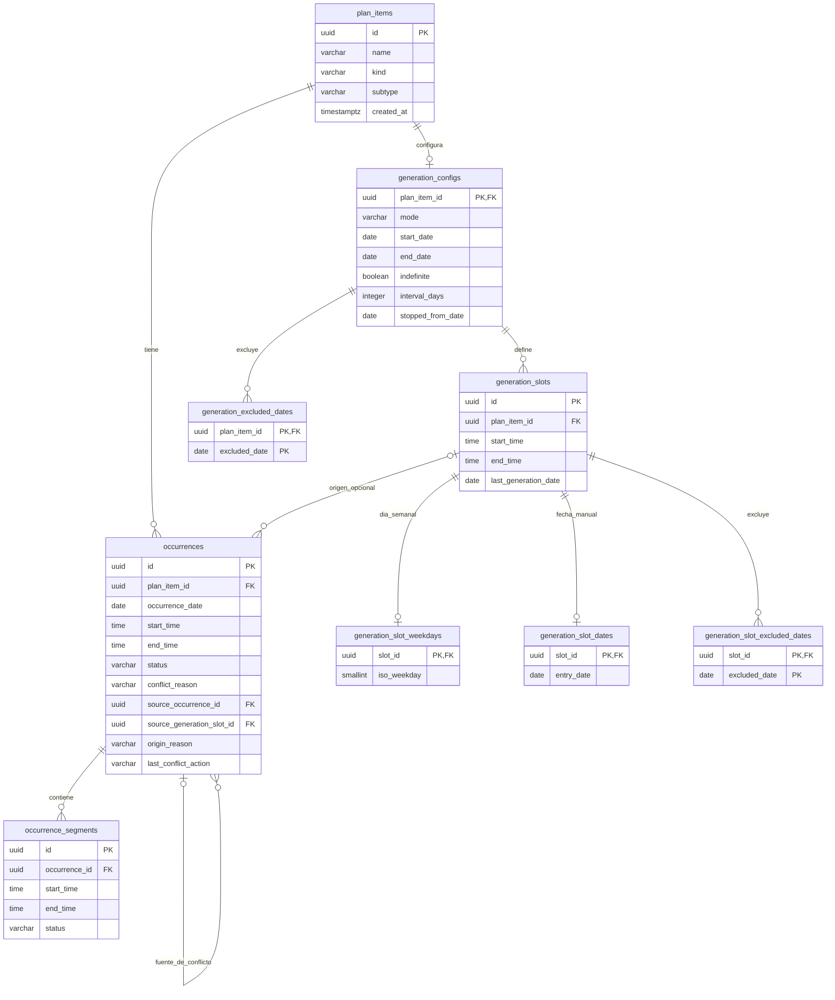

# Modelo PostgreSQL — Gestor de hábitos

[Presentación](/README.md) · [Funcionamiento](/docs/funcionamiento.md) · [Instalación local](/docs/instalacion-local.md)

La base de datos conserva la identidad de las actividades, sus reglas de generación,
las apariciones en el calendario y sus segmentos. Este documento describe el
**esquema resultante de las migraciones 001 a 005**, inspeccionadas como archivos;
no representa una consulta del estado actual de un servidor PostgreSQL.

## 1. Modelo entidad-relación

Las cardinalidades del diagrama son las que permiten las claves y restricciones
SQL: `||` significa uno, `o|` cero o uno y `o{` cero o muchos. Las condiciones
adicionales del dominio se explican después. Todas las tablas pertenecen a `public`.

El diagrama incluye las **nueve tablas permanentes** finales, sus columnas y diez
relaciones de clave foránea. Las tablas temporales utilizadas por la migración 003
no forman parte del modelo persistente.

## 2. Tablas y responsabilidades

| Tabla | Responsabilidad |
| --- | --- |
| `plan_items` | Identidad, nombre, clasificación y fecha de creación de cada actividad o hábito |
| `generation_configs` | Una configuración como máximo por PlanItem: modalidad, rango, intervalo y corte global |
| `generation_slots` | Horarios con identidad propia y, desde 005, corte individual opcional |
| `generation_slot_weekdays` | Día ISO de un slot semanal: lunes 1 a domingo 7 |
| `generation_slot_dates` | Fecha explícita de un slot manual |
| `generation_slot_excluded_dates` | Fechas que un slot concreto no debe generar |
| `generation_excluded_dates` | Fechas excluidas para la configuración completa |
| `occurrences` | Apariciones materializadas, su rango general, estado agregado y procedencia |
| `occurrence_segments` | Tramos de una aparición, con inicio, fin y estado propios |

### Cardinalidades y claves

- `generation_configs.plan_item_id` es simultáneamente PK y FK. SQL permite un
  PlanItem sin configuración, pero el flujo actual de creación guarda ambos y
  los servicios conectados esperan esa configuración. La FK no obliga a crearla.
- Un slot pertenece obligatoriamente a una configuración. Esta puede tener cero
  o muchos slots según SQL; las validaciones de creación exigen horarios válidos.
- `slot_id` es PK en cada tabla de detalle: un slot tiene como máximo un registro
  en `generation_slot_weekdays` y uno en `generation_slot_dates`. El dominio escoge
  el detalle según el modo; SQL no prohíbe por sí solo que existan ambos.
- Las exclusiones tienen PK compuestas `(plan_item_id, excluded_date)` y
  `(slot_id, excluded_date)`, evitando repetir la misma excepción.
- Cada aparición requiere un PlanItem, pero su `source_generation_slot_id` puede
  ser `NULL` para apariciones ad hoc o procedencia que ya no se conserva. Esta FK
  no garantiza por sí sola que el slot pertenezca al mismo PlanItem: el backend
  valida esa coherencia.
- `source_occurrence_id` es una autorreferencia opcional de `occurrences`: identifica
  la aparición fuente del conflicto. Una fuente puede ser referenciada por varias
  apariciones. No es la relación entre aparición y segmento.
- Cada segmento requiere una aparición. SQL permite cero segmentos por aparición;
  **la aplicación exige uno o más** y valida el conjunto final en sus escritores.

Los UUID de los registros nuevos se asignan desde la aplicación; no hay un
`DEFAULT` UUID en estas tablas. Las PK y FK evitan depender de nombres u horarios
como identidad. `created_at` tiene `DEFAULT NOW()`.

### Efectos de las claves foráneas al borrar

| Referencia: tabla hija → tabla padre | `ON DELETE` |
| --- | --- |
| `generation_configs.plan_item_id → plan_items.id` | `NO ACTION` por defecto |
| `occurrences.plan_item_id → plan_items.id` | `NO ACTION` por defecto |
| `generation_excluded_dates.plan_item_id → generation_configs.plan_item_id` | `NO ACTION` por defecto |
| `generation_slots.plan_item_id → generation_configs.plan_item_id` | `CASCADE` |
| `generation_slot_weekdays.slot_id → generation_slots.id` | `CASCADE` |
| `generation_slot_dates.slot_id → generation_slots.id` | `CASCADE` |
| `generation_slot_excluded_dates.slot_id → generation_slots.id` | `CASCADE` |
| `occurrences.source_generation_slot_id → generation_slots.id` | `SET NULL` |
| `occurrences.source_occurrence_id → occurrences.id` | `NO ACTION` por defecto |
| `occurrence_segments.occurrence_id → occurrences.id` | `CASCADE` |

Eliminar un slot no elimina sus apariciones: deja su procedencia en `NULL`.
Eliminar una aparición sí elimina sus segmentos. Las referencias de conflicto
pueden impedir ese borrado; los servicios no las limpian indiscriminadamente.
Estas cascadas son garantías SQL, no una API para borrar PlanItems completos.

## 3. Recurrencia, apariciones y segmentos

`generation_configs.mode` admite `weekly`, `interval_days` y `manual_dates`:

- `weekly`: slots con un día ISO en `generation_slot_weekdays`.
- `interval_days`: slots aplicados cada N días desde `start_date`, sin fila de
  detalle semanal o manual.
- `manual_dates`: slots con fechas en `generation_slot_dates`.

Un PlanItem puede tener varios slots el mismo día. Generar una aparición guarda
su fecha, horario y slot de origen. El índice único parcial
`uq_occurrences_source_generation_slot_date` permite como máximo una aparición
por `(source_generation_slot_id, occurrence_date)` cuando el slot no es `NULL`.
Las apariciones ad hoc sin slot quedan fuera de esa unicidad.

Las apariciones nuevas reciben inicialmente un segmento que ocupa todo su rango.
Las ediciones pueden producir varios segmentos y huecos. Cambiar la configuración
recurrente no equivale a reconstruir sin condiciones todo el historial: los
servicios deciden qué bases pendientes ajustar y qué excepciones conservar.

Los dos límites persistentes se interpretan así:

| Campo | Interpretación en los materializadores |
| --- | --- |
| `generation_configs.stopped_from_date` | Primera fecha que ya no se genera: límite exclusivo para las fechas permitidas |
| `generation_slots.last_generation_date` | Última fecha permitida de ese slot: límite inclusivo |

`NULL` significa que ese corte no se aplica; las fechas inicial/final y las
exclusiones siguen vigentes. Detener después de D escribe D en los slots afectados
y, para el corte global, D+1 en la configuración. Los comandos solo acortan límites
existentes; no implementan reanudación.

La migración 005 añade la columna nullable sin eliminar slots ni alterar su
procedencia. No agrega una restricción SQL que compare el corte con las fechas de
apariciones: el materializador y los servicios hacen cumplir esa regla.

## 4. Integridad: qué garantiza cada capa

### Restricciones SQL

- `kind` admite `activity` o `habit`; la combinación con `subtype` limita las
  actividades a `anchor`, `periodic`, `event`, `unexpected` y los hábitos a `scheduled`.
- El nombre es obligatorio y de longitud máxima 150; no tiene restricción de
  unicidad. Nombres iguales no prueban identidad compartida.
- Las configuraciones validan modo y rango. `weekly` e `interval_days` requieren
  `start_date`; `interval_days` requiere intervalo positivo. Un plan indefinido
  no tiene `end_date`; uno finito sí. `manual_dates` no lleva rango recurrente,
  intervalo ni marca indefinida.
- Slots, apariciones y segmentos exigen `start_time < end_time`. Los días ISO
  están entre 1 y 7. El modelo no representa un intervalo que cruce medianoche
  dentro de una sola fila.
- Apariciones y segmentos admiten los mismos seis estados: `pending`,
  `in_progress`, `completed`, `not_completed`, `not_finished`, `cancelled`.
- `conflict_reason` y `source_occurrence_id` deben ser ambos nulos o ambos no
  nulos. Los motivos permitidos son `priority_override` y `user_forced_override`.
  Una aparición no puede referenciarse directamente a sí misma como fuente;
  esta restricción no constituye una detección general de ciclos.
- `origin_reason`, si existe, es `conflict_insertion`; `last_conflict_action`,
  si existe, es `conflict_insertion` o `conflict_move`. No hay un log de eventos
  completo: estos campos guardan metadatos de procedencia y última acción.
- `excl_occurrence_segments_sibling_overlap` impide solapamientos entre segmentos
  de la misma aparición mediante GiST y `btree_gist`. Usa rangos `[inicio, fin)`,
  acepta extremos contiguos y es `DEFERRABLE INITIALLY DEFERRED`, para comprobar
  el resultado de una edición compuesta al finalizar la transacción.

### Reglas de la aplicación

La exclusión SQL anterior **no detecta conflictos entre apariciones distintas**.
El backend consulta los segmentos ocupantes de la misma fecha y valida la operación
completa. También exige que todos los segmentos estén dentro del rango del padre,
que exista al menos uno y que sus horarios se representen con precisión HH:MM.

La compatibilidad de los detalles de un slot con el modo, la pertenencia del slot
al PlanItem correcto, la protección del historial y los permisos de cada operación
son reglas de los servicios. No existen triggers que hagan cumplir toda esa lógica.
Por eso escribir SQL manualmente no equivale a pasar por la API.

Las operaciones conectadas utilizan transacciones, y los comandos de mutación
emplean aislamiento `SERIALIZABLE` y bloqueos cuando corresponden. Ante conflictos
de concurrencia se devuelve un error controlado; las escrituras parciales de la
operación se revierten.

## 5. Persistencia de estados y tiempo local

`occurrence_segments.status` almacena el estado de cada tramo.
`occurrences.status` guarda su agregado, calculado por el dominio y actualizado
en la misma transacción. No es un campo de edición independiente ni una columna
generada por SQL. Los CHECK aceptan los seis valores, pero no verifican que el
padre coincida con los hijos.

La ventana de corrección usa un día calendario anterior: hoy y ayer son editables,
fechas anteriores quedan congeladas. Futuro admite `pending` y `cancelled`; hoy
admite los seis estados, con `completed` solo al alcanzar la hora final; ayer admite
los cuatro estados estables. La regla se aplica en el backend, no en un CHECK
basado en `CURRENT_DATE`.

Al cargar el gestor, la reconciliación transforma segmentos de días anteriores:
`pending → not_completed` e `in_progress → not_finished`, y recalcula los agregados.
Esto incluye ayer y los días congelados pendientes de normalización. No ejecuta
una tarea programada en PostgreSQL. El endpoint de estado consulta datos; la
reconciliación se solicita mediante un POST separado.

Las fechas usan `DATE` y los horarios `TIME` sin zona horaria. `created_at` usa
`TIMESTAMPTZ`. El servidor decide con su calendario local; no hay una columna de
zona horaria por usuario. Las reglas completas y ejemplos están en la
[guía funcional](/docs/funcionamiento.md).

## 6. Evolución del esquema

Los archivos se encuentran en
[`db/migrations/`](/modules/gestor_de_habitos/db/migrations/). Se aplican en orden,
una vez, y cada uno delimita su propia transacción.

| Migración | Cambio principal |
| --- | --- |
| [001_initial_schema.sql](/modules/gestor_de_habitos/db/migrations/001_initial_schema.sql) | Introduce PlanItems, configuraciones, apariciones, días semanales, fechas manuales y exclusiones globales |
| [002_fix_occurrence_status_context.sql](/modules/gestor_de_habitos/db/migrations/002_fix_occurrence_status_context.sql) | Corrige el CHECK de contexto para no admitir una referencia de origen con motivo nulo por la lógica SQL de valores desconocidos |
| [003_multi_slot_scheduling.sql](/modules/gestor_de_habitos/db/migrations/003_multi_slot_scheduling.sql) | Introduce slots, sus detalles y exclusiones; migra horarios; añade procedencia e índice único slot/fecha; elimina `generation_weekdays`, `generation_date_entries` y los horarios por defecto de la configuración |
| [004_occurrence_segments.sql](/modules/gestor_de_habitos/db/migrations/004_occurrence_segments.sql) | Renombra `status_reason` a `conflict_reason`, añade metadatos, crea segmentos y exclusión GiST; convierte cada aparición existente en un segmento equivalente y verifica el backfill |
| [005_generation_slot_cutoff.sql](/modules/gestor_de_habitos/db/migrations/005_generation_slot_cutoff.sql) | Añade `generation_slots.last_generation_date DATE NULL`, conservando sin corte individual los slots existentes |

La 004 retira la restricción antigua que vinculaba el motivo de conflicto solo
con `cancelled` o `not_finished`: el motivo ahora registra también cambios de
estructura. `status_reason` ya no existe en el esquema final.

La creación de una base nueva y las precauciones para una base existente están
en [instalación local](/docs/instalacion-local.md). Este documento no aplica migraciones.

## 7. Registro histórico del entorno y rollout

Información conservada del registro previo del proyecto:

- PostgreSQL 16; base local `vcs_dev`; rol de aplicación local `vcs_app`.
- Administración visual mediante DBeaver Community.
- El 22 de septiembre de 2026 se registró la migración y verificación de `vcs_dev`
  hasta schema 005.
- `004_occurrence_segments.sql` se registró como aplicada, con backfill e integridad
  verificados; `005_generation_slot_cutoff.sql`, conservando en `NULL` los cortes
  de todos los horarios preexistentes.
- Se registró un respaldo custom-format previo al rollout, verificado y conservado
  fuera del repositorio. Como ubicación de ejemplo puede utilizarse
  `~/.local/share/vcs/backups/vcs_dev_pre_005.dump`; el nombre real puede incluir
  la fecha y hora de creación.

Este registro histórico no se volvió a verificar contra PostgreSQL al reorganizar
la documentación. El [contrato de terminación](/modules/gestor_de_habitos/docs/planning_termination_api.md)
todavía contiene una nota de rollout pendiente; esa contradicción documental queda
señalada para revisión, sin inferir el estado actual del servidor.

## 8. Referencias de implementación

- [Lectura del estado persistido](/modules/gestor_de_habitos/backend/repositories/planner_state_repository.py).
- [Reglas de estados y agregado](/modules/gestor_de_habitos/backend/occurrence_segment_domain.py).
- [Validación estructural](/modules/gestor_de_habitos/backend/occurrence_structure_domain.py).
- [Materialización](/modules/gestor_de_habitos/backend/plan_item_materializer.py).
- [Terminación de planificación](/modules/gestor_de_habitos/backend/planning_termination_service.py).
- [Pruebas de migración 004](/modules/gestor_de_habitos/db/test_migration_004.py) y
  [pruebas de terminación con PostgreSQL](/modules/gestor_de_habitos/backend/test_planning_termination_integration.py).
  Estas integraciones no se ejecutaron para preparar esta documentación.
